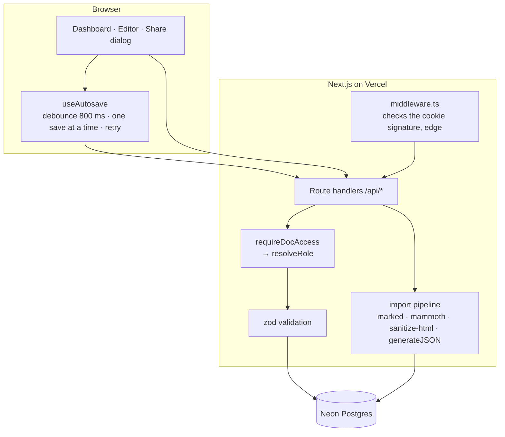
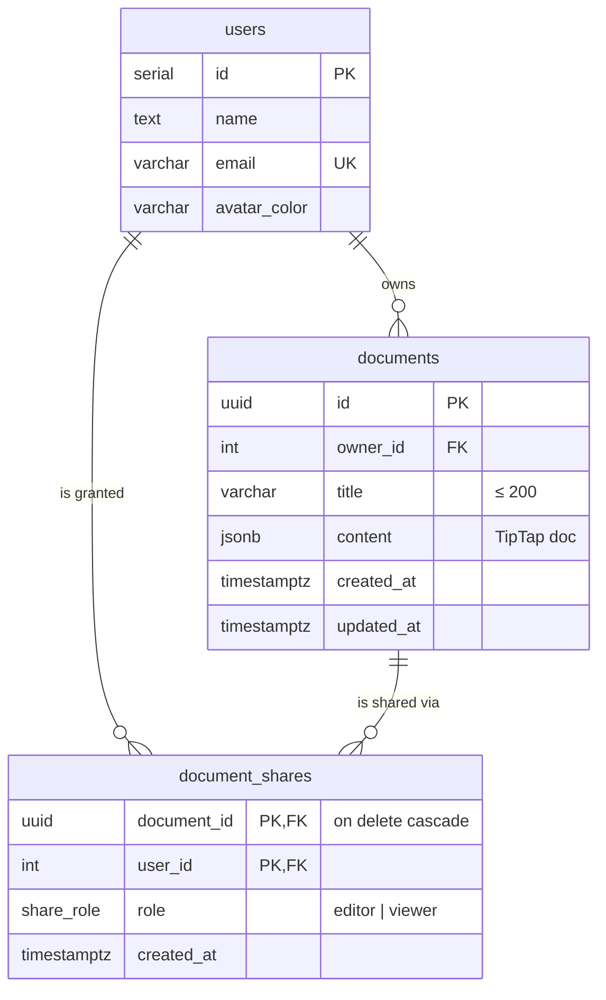

# Architecture note

> **In one line:** a single Next.js app with Postgres, built around one rule: *every request goes through one tested access check*. Real-time collaboration was deliberately deferred so the core flow could be finished and verified.

## 1. What I prioritised, and why

The brief rewards product judgment and end-to-end working flows over feature count. With four hours, I ranked the work like this:

| Priority | Area | Reasoning |
|---|---|---|
| 1 | **Access control correctness** | Sharing is where a docs app can actually hurt users, by leaking or overwriting someone else's work. It got one pure, unit-tested function and server-side enforcement on every route |
| 2 | **Persistence that preserves structure** | Documents are stored as **TipTap JSON**, not HTML, so headings, lists and marks survive exactly, and invalid shapes are rejected by validation |
| 3 | **A good-enough editing experience** | Toolbar, shortcuts, an autosave that never sends overlapping saves, a visible save state, and a retry on failure |
| 4 | **Import that is safe by construction** | Uploaded files are untrusted input: sanitised, then forced through the editor's own schema |
| 5 | **A shippable, testable deploy** | Live URL, seeded users, and smoke tests run against production |
| Deferred | Real-time co-editing, real auth, history, comments, export | Each is a project of its own; a partial version would have been a broken one |

## 2. System overview

- **One deployable.** UI and API share types (for example `DocListItem` and `ShareEntry`) and deploy together.
- **Server components** load data for the dashboard and editor pages directly, so there's no client-side loading flash. The client only calls the API to change things.
- **Middleware** only checks that the session cookie's signature is valid. It doesn't touch the database, so it stays fast at the edge. The real authorisation happens in the route handlers.

## 3. Data model

- **Ownership is a column, not a share row.** There's exactly one owner per document, which can't drift out of sync with the share list.
- **The composite primary key `(document_id, user_id)`** makes duplicate shares impossible; sharing again simply updates the role.
- **Indexes** on `documents.owner_id` and `document_shares.user_id` back the two dashboard queries.
- **UUID document IDs** can't be guessed by counting, and malformed IDs return `404` before reaching the database.

## 4. Access model

`resolveRole(userId, doc, shares) → 'owner' | 'editor' | 'viewer' | null` is a pure function with no I/O. Every document route calls `requireDocAccess(docId, minRole)`:

| Action | Minimum role | Response if not allowed |
|---|---|---|
| Read | viewer | `404` (stranger) |
| Edit title or content | editor | `403` (viewer) · `404` (stranger) |
| Share, change role, unshare, delete | owner | `403` (editor or viewer) · `404` (stranger) |

**Why 404 rather than 403 for strangers?** A 403 would confirm that a document with that ID exists. A 404 reveals nothing.

The UI mirrors the rules (read-only editor and banner for viewers, Share button only for owners), but it is never trusted. This is covered by `tests/api-permissions.test.ts`, which runs the real route handlers.

## 5. Key implementation decisions

| Decision | Alternatives considered | Why this one |
|---|---|---|
| **Next.js full-stack** | Separate SPA + Express API | Half the infrastructure, one deploy, shared types |
| **TipTap, stored as JSON** | Quill, Slate, storing HTML | Schema-based editor; JSON keeps structure exact and is easy to validate; it also leaves a path to real-time collaboration through Yjs |
| **Postgres (Neon) + Drizzle** | SQLite, a JSON file, Supabase | Sharing needs relational queries across users; Neon is free and serverless-friendly; Drizzle is typed with no codegen |
| **Mocked auth with signed JWT cookies** | NextAuth/OAuth, no auth at all | The brief allows mocked users; signing still prevents impersonating someone by editing a cookie |
| **Last-write-wins autosave** | OT/CRDT, locking | Honest and predictable for one editor at a time; real-time sync is the top roadmap item |
| **Autosave: debounced, one save at a time, merged pending changes** | Save on every keystroke, or a manual Save button | Few requests, no out-of-order saves, and a failed save keeps your pending edit so Retry or the next keystroke resends it |
| **`sanitize-html` + editor schema** | DOMPurify on jsdom | Two layers of defence, and no DOM library. The jsdom version crashed on Vercel's function runtime (see §7) |
| **zod at every API boundary** | Ad-hoc checks | One place for limits: title 1–200 characters, content is a TipTap doc of at most about 1 MB, unknown fields rejected |

## 6. Error handling and validation

- **400:** invalid body (zod), blank or over-long title, content that isn't a TipTap doc, unknown fields (for example, trying to set `ownerId`).
- **401:** signed out (API). Signed-out page visits redirect to `/login?next=…`.
- **403 / 404:** see the access model above.
- **Import:** `415` unsupported type · `413` over 2 MB · `400` empty · `422` corrupt `.docx` or binary "text" file.
- **UI:** toasts for failures, inline form errors in the Share dialog, a save indicator with Retry, a "Document not found" page, empty states and a loading skeleton.

## 7. Deployment notes

- **Vercel + Neon** through the Vercel Marketplace; the schema is created with `drizzle-kit push`, and pushing to `main` deploys automatically.
- **Production bug caught by a smoke test:** `/api/import` returned 500 only on Vercel (`ERR_REQUIRE_ESM`). Vercel's function loader can't `require()` ES-module packages from `node_modules`. The fix was to drop the `jsdom`-based sanitiser and let Next.js bundle the ES-module dependencies (`happy-dom`, `marked`).

## 8. Trade-offs I'm aware of

| Trade-off | Impact | Mitigation now | Proper fix |
|---|---|---|---|
| Last write wins | Concurrent editors overwrite each other | Autosave is frequent; roles limit who can write | Yjs/CRDT or OT over WebSockets (see README roadmap) |
| Mocked auth | Anyone can pick any demo user | Signed cookies; demo-only data | OAuth / magic links |
| Owner-only share list | Editors can't see who else has access | Clear role badge | Read-only access list for all collaborators |
| No rate limiting | Import endpoint could be spammed | 2 MB cap, type checks | Edge rate limiting per user |
