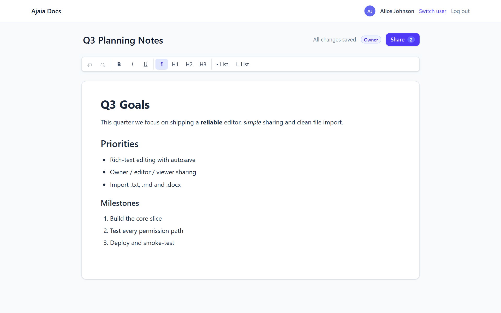
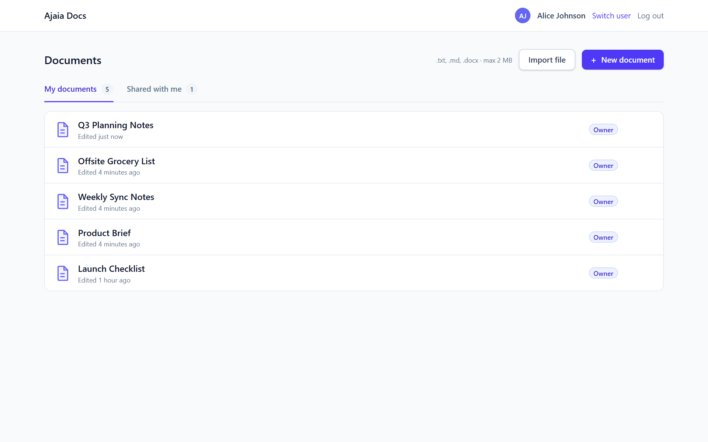
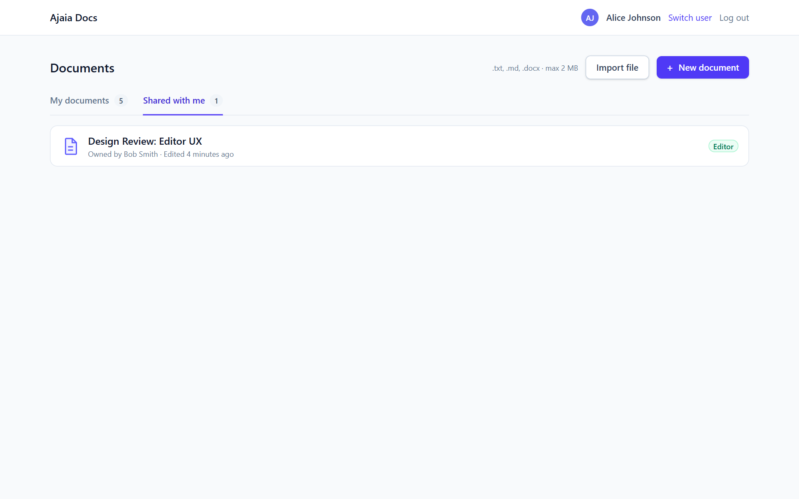
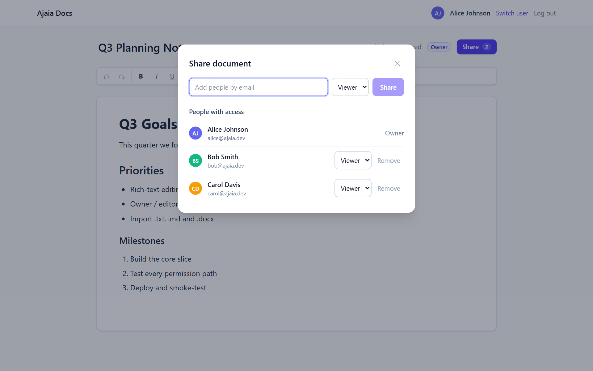
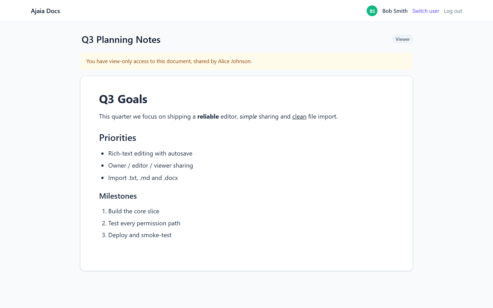
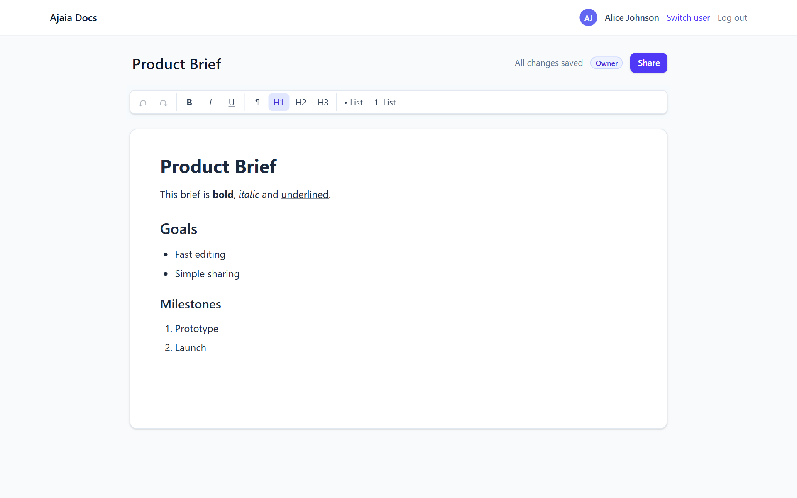
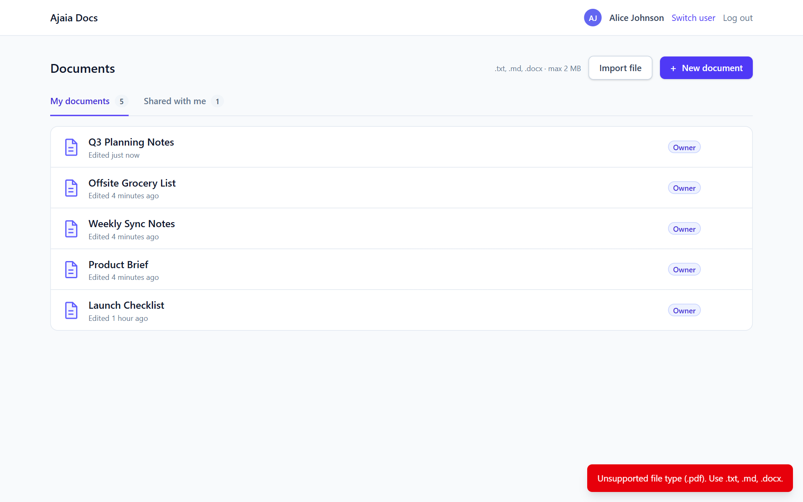
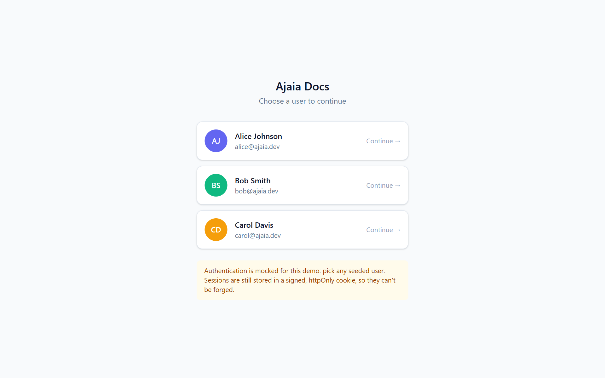
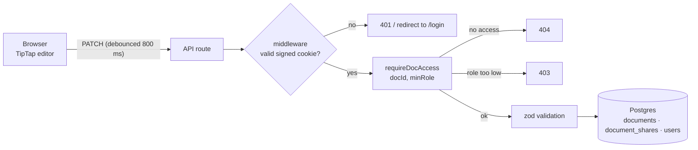

<div align="center">

# Ajaia Docs

**A lightweight collaborative document editor: write, format, share and import documents.**

Built in a 4-hour timebox for the Ajaia LLC *AI-Native Full Stack* take-home.

[**Live demo**](https://ajaia-docs-five-phi.vercel.app) · [Architecture](ARCHITECTURE.md) · [AI workflow](AI_WORKFLOW.md) · [Submission notes](SUBMISSION.md)




</div>

---

## Contents

- [Why this project looks the way it does](#why-this-project-looks-the-way-it-does)
- [Features](#features)
- [Try it in 2 minutes](#try-it-in-2-minutes)
- [Screenshots](#screenshots)
- [Tech stack](#tech-stack)
- [Run it locally](#run-it-locally)
- [How it works](#how-it-works)
- [Testing](#testing)
- [Deployment](#deployment)
- [What I deliberately left out](#what-i-deliberately-left-out)
- [Roadmap](#roadmap)
- [Project structure](#project-structure)
- [Reviewer docs](#reviewer-docs)

---

## Why this project looks the way it does

I had **four hours**. With an AI pair programmer I could have generated far more surface area: real-time cursors, comments, version history, export. I chose not to.

Instead I built **one small slice and validated every part of it**: create → edit → save → share → open as another user → import. Every permission rule is enforced on the server, unit-tested, and checked again against the live deployment.

> **A small system that is proven to work beats a large one with broken flows.**
> Everything in the [Roadmap](#roadmap) is a deliberate *next step*, not something I forgot.

---

## Features

| | |
|---|---|
| ✍️ **Rich-text editing** | Bold, italic, underline, H1–H3, bulleted and numbered lists, undo/redo, keyboard shortcuts |
| 💾 **Autosave** | Saves ~800 ms after you stop typing. The status indicator shows *Unsaved → Saving… → Saved*, or an error with **Retry**. You're warned before leaving with unsaved changes |
| 🔗 **Sharing with roles** | Share by email as **Editor** or **Viewer**; change roles or remove access at any time. Only the owner can manage sharing |
| 👀 **Read-only mode** | Viewers get a locked editor and a banner, with no toolbar. The server rejects their writes with `403` |
| 📥 **File import** | `.txt`, `.md` and `.docx` (≤ 2 MB) become new documents. Headings, lists and formatting are preserved, and the HTML is sanitised |
| 🗂️ **Dashboard** | **My documents** and **Shared with me** tabs, with role badges, owner names and relative "edited" times |
| 🔐 **Mocked, but unforgeable, auth** | Pick a seeded user. The session is an HS256-signed JWT in an `httpOnly` cookie |

---

## Try it in 2 minutes

Open the **[live demo](https://ajaia-docs-five-phi.vercel.app)**. Authentication is mocked, so just pick a user.

| User | Email |
|---|---|
| Alice Johnson | `alice@ajaia.dev` |
| Bob Smith | `bob@ajaia.dev` |
| Carol Davis | `carol@ajaia.dev` |

1. **As Alice:** click **New document**, give it a title, and format some text. Refresh the page; everything persists.
2. Click **Share**, add `bob@ajaia.dev` as **Viewer**.
3. **Switch user → Bob** (or use a private window). The doc is under **Shared with me**, opens read-only, and has no toolbar.
4. **As Alice**, change Bob to **Editor**. Bob can now edit, and Alice sees his changes after a refresh.
5. **As Carol**, open the same URL: **"Document not found"** (404). The app never reveals that a document exists.
6. **Import** [`samples/product-brief.docx`](samples/product-brief.docx) or [`samples/meeting-notes.md`](samples/meeting-notes.md). Try [`samples/unsupported.pdf`](samples/unsupported.pdf) to see the error.

---

## Screenshots

| Dashboard | Shared with me |
|---|---|
|  |  |
| **Share dialog** | **Viewer (read-only) mode** |
|  |  |
| **Imported .docx** | **Unsupported file → clear error** |
|  |  |

<details>
<summary>Login screen</summary>


</details>

---

## Tech stack

| Layer | Choice | Why |
|---|---|---|
| App | **Next.js 15** (App Router) + **TypeScript** | UI and API in one repo and one deploy, so there are fewer moving parts |
| Editor | **TipTap 3** (ProseMirror) | Mature, schema-based editor; documents are stored as structured JSON, not HTML |
| Database | **Postgres on Neon** + **Drizzle ORM** | Free, persistent and serverless-friendly; Drizzle is typed with no codegen step |
| Validation | **zod** | One schema validates every API input |
| Auth | **jose** (HS256 JWT) in an `httpOnly` cookie | Mocked login that still can't be forged by editing a cookie |
| Import | **mammoth** (.docx), **marked** (.md), **sanitize-html** | Covers the brief's file types; allowlist sanitiser with no DOM dependency |
| UI | **Tailwind CSS 4** + hand-rolled components | Fast to build and clean, with no heavy UI kit |
| Tests | **Vitest** | 44 tests: access rules, sessions, import, API permissions |
| Hosting | **Vercel** + **Neon** | Pushing to `main` deploys automatically |

---

## Run it locally

**Prerequisites:** Node 24+, and Docker (for the local Postgres). Alternatively, point `DATABASE_URL` at any Postgres, such as a free Neon branch.

```bash
git clone https://github.com/sidddha2004/ajaia-docs.git
cd ajaia-docs
npm install
cp .env.example .env        # local defaults work with the Docker database
npm run db:up               # Postgres 16 on localhost:5433
npm run db:push             # create tables
npm run db:seed             # add Alice, Bob and Carol
npm run dev                 # http://localhost:3000
```

### Environment variables

| Variable | Description |
|---|---|
| `DATABASE_URL` | Postgres connection string. Use Neon's **pooled** URL in production |
| `SESSION_SECRET` | Long random string used to sign session cookies (at least 16 characters) |

### Scripts

| Command | What it does |
|---|---|
| `npm run dev` / `build` / `start` | Next.js dev server / production build / production server |
| `npm test` / `npm run test:watch` | Run the Vitest suites once / in watch mode |
| `npm run lint` | ESLint |
| `npm run db:up` | Start the local Postgres container |
| `npm run db:push` | Sync the Drizzle schema to the database |
| `npm run db:seed` | Seed the three demo users (safe to re-run) |
| `npm run db:studio` | Browse the database in Drizzle Studio |

---

## How it works



### Access control: one function, used everywhere

Every document route calls `requireDocAccess(docId, minRole)`, which uses a pure, unit-tested `resolveRole()`:

| Action | Minimum role |
|---|---|
| Read a document | viewer |
| Edit title / content | editor |
| Share, change roles, unshare, delete | owner |

- **No access → `404`**, so strangers can't even confirm a document exists.
- **Access, but too low a role → `403`**.
- The UI mirrors these rules (read-only editor, hidden Share button), but **the server is the source of truth**.

### Import pipeline

`file → type and size checks → HTML (marked / mammoth / escaped text) → sanitize-html allowlist → TipTap JSON using the editor's own schema`

There are two layers of defence. The sanitiser removes scripts, handlers and unsafe URLs. Converting into the editor's schema then drops anything the editor doesn't support, such as tables, images and links.

More detail: **[ARCHITECTURE.md](ARCHITECTURE.md)**.

---

## Testing

```bash
npm test
```

```
 ✓ tests/access.test.ts           role resolution + full role-ordering matrix
 ✓ tests/session.test.ts          signed tokens; tampered and alg:none tokens rejected
 ✓ tests/import.test.ts           txt/md/docx conversion, XSS stripping, 415/413/422 rejections
 ✓ tests/api-permissions.test.ts  real route handlers: stranger → 404, viewer PATCH → 403,
                                  editor DELETE/share → 403, invalid input → 400

 Test Files  4 passed (4)
      Tests  44 passed (44)
```

To check that the permission tests actually work, I temporarily weakened the PATCH route to allow viewers. The suite failed, and then I restored the code.

Beyond unit tests, every build step was checked end to end: `curl` permission checks against the dev server, the real UI in a browser, and finally the same checks against the **live Vercel deployment**.

---

## Deployment

Hosted on **Vercel**, with **Neon Postgres** added through the Vercel Marketplace. Pushing to `main` deploys automatically.

```bash
vercel link
vercel integration add neon      # sets DATABASE_URL for every environment
vercel env add SESSION_SECRET production
DATABASE_URL=<neon-unpooled-url> npm run db:push && npm run db:seed
git push                         # deploys
```

> **Lesson learned in production:** imports worked locally but returned 500 on Vercel with `ERR_REQUIRE_ESM`. Vercel's function loader can't `require()` ES-module packages from `node_modules`. I replaced the `jsdom`-based sanitiser with `sanitize-html` and let Next.js bundle the ES-module dependencies. A live smoke test caught this before any reviewer did.

---

## What I deliberately left out

| Cut | Why |
|---|---|
| **Real-time co-editing** (WebSockets, OT/CRDT) | The biggest piece of work in a docs app. A half-built version would have been a broken one. Saving is **last-write-wins** for now |
| **Real authentication** | Passwords and OAuth add risk and time without demonstrating the core product. Sessions are still signed and can't be forged |
| **Version history, comments** | Each needs its own data model and UI; out of scope for 4 hours |
| **Images, tables, links** | Kept the editor schema small; this also keeps imports safe |
| **Export** | Lower value than import for the demo |

**Optional stretch:** the role-based sharing (**Editor** vs **Viewer**, enforced on the server) covers *"role-based sharing permissions beyond basic access"*. I didn't build the other stretch items, so I wouldn't eat into time for the core flows. [SUBMISSION.md](SUBMISSION.md#optional-stretch) has a short plan for how each would be built.

**Known limitations:**
- Two people editing the same doc at once will overwrite each other (last write wins).
- The Share dialog doesn't trap keyboard focus.
- The demo-user email suggestions are fine for three users but wouldn't scale.
- There's no rate limiting.

---

## Roadmap

### 1. Real-time collaboration (the big one)
- **WebSocket sync layer** so edits stream live instead of being saved by polling-style autosave.
- **Conflict-free concurrent editing**, using either:
  - **Operational Transformation (OT)**, the approach Google Docs uses: every edit is an operation, and the server transforms concurrent operations against each other so all clients converge; or
  - a **CRDT** such as **Yjs**, which TipTap supports directly (`@tiptap/extension-collaboration`) and which also enables offline editing.
- **Presence:** live cursors, selections and "who's here" avatars.
- A cheap step in between: **optimistic concurrency** (reject a save if `updated_at` changed since the client loaded the doc) to warn about overwrites before full real-time sync exists.

### 2. Collaboration features
- **Version history** with restore (snapshot the document on save).
- **Comments and suggestions** anchored to text ranges.
- **Share links** (anyone with the link can view or edit) and access requests.

### 3. Platform
- **Real auth** (OAuth / magic links) and organisations.
- **Export** to Markdown, PDF and `.docx`.
- **Images, tables and links** in the editor, with safe URL handling.
- **Search** across documents, plus pagination.
- Accessibility pass (focus trap in dialogs), rate limiting, and audit logs.

---

## Project structure

```
src/
├── app/
│   ├── (dashboard)/        # "/" dashboard + loading skeleton
│   ├── doc/[id]/           # editor page + 404 page
│   ├── login/              # mocked login
│   └── api/
│       ├── session/        # POST login · DELETE logout
│       ├── documents/      # list · create
│       │   └── [id]/       # get · patch · delete
│       │       └── shares/ # list · share/update role · [userId] remove
│       └── import/         # multipart upload → new document
├── components/             # Editor, Toolbar, ShareDialog, DocList, ImportButton, …
├── hooks/useAutosave.ts    # debounced, single-flight, retrying autosave
├── lib/
│   ├── access.ts           # pure role rules (unit-tested)
│   ├── api.ts              # requireUser / requireDocAccess guards
│   ├── import.ts           # parse → sanitise → TipTap JSON
│   ├── session.ts          # sign / verify session cookie
│   └── validation.ts       # zod schemas
├── db/                     # Drizzle schema, client, seed
└── middleware.ts           # redirects signed-out users to /login
tests/                      # Vitest suites
samples/                    # demo files for import
docs/screenshots/           # README images
```

---

## Reviewer docs

| File | What's in it |
|---|---|
| [SUBMISSION.md](SUBMISSION.md) | Exactly what's included, a requirement-by-requirement checklist, what's working or incomplete, and the next 2–4 hours |
| [ARCHITECTURE.md](ARCHITECTURE.md) | What I prioritised and why, the data model, the access model, and the trade-offs |
| [AI_WORKFLOW.md](AI_WORKFLOW.md) | AI tools used, where they helped, what I changed or rejected, and how I verified the work |
| [VIDEO_URL.txt](VIDEO_URL.txt) | Walkthrough video link |

Everything runs on free tiers (Vercel Hobby, Neon Free), so reviewers don't pay for anything.
